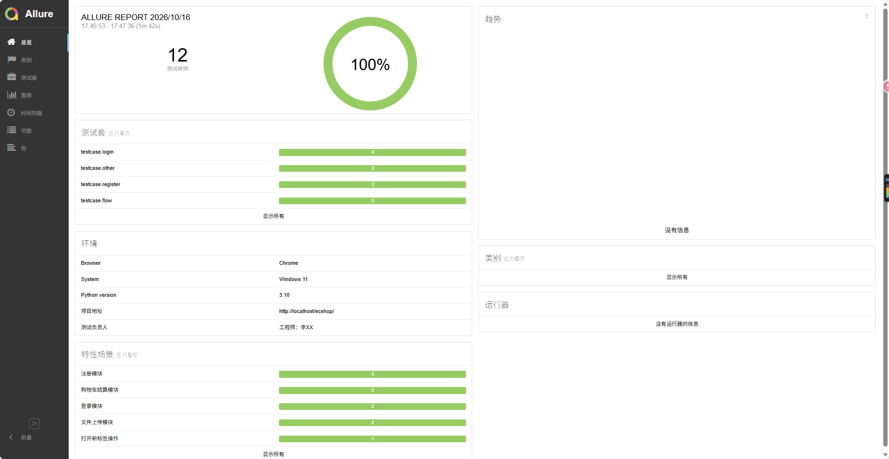
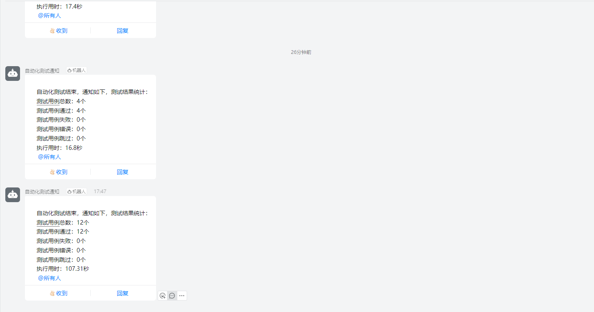

# WebUI-Test-auto

基于 Python + Selenium + Pytest + Allure 的 Web UI 自动化测试框架。

> 本项目为本地项目，依赖本地 ECSHOP 商城，运行前请确保本地环境已就绪。

## 技术栈

- Python 3.10
- Selenium 4.x
- Pytest
- Allure
- PyMySQL
- Page Object Model (POM)

## 项目结构

```txt
WebUI-Test-auto/
├── config/          # 配置文件（host、数据库等）
├── data/            # 测试数据（json / yaml / excel）
├── log/             # 日志文件
├── pageObject/      # 页面对象（POM 分层）
│   ├── login_page/  # 登录页
│   ├── register_page/ # 注册页
│   ├── flow_page/   # 购物车结算页
│   ├── search_page/ # 购物车搜索页
│   └── other/       # 文件上传等其他页面
├── report/          # 测试报告存放处
├── screenshot/      # 图片存放位置
├── testcase/        # 测试用例
│   ├── login/
│   ├── register/
│   ├── flow/
│   ├── other/
│   └── conftest.py  # pytest 局部 fixture 和钩子
├── util_tools/      # 工具类
│   ├── basePage.py  # 基础页面类，封装通用操作
│   ├── connectMysql.py # 数据库操作
│   ├── dingRebot.py # 钉钉机器人
│   ├── handle_data/ # 数据读取（json / yaml / excel）
│   └── logs_util/   # 日志输出
├── conftest.py      # pytest 全局 fixture 和钩子
├── pytest.ini       # pytest 配置
├── environment.xml  # 测试环境信息
├── requirements.txt # 依赖
└── run.py           # 入口
```

## 核心特性

- **POM 设计模式**：BasePage 封装 50+ 通用操作（元素定位、点击、输入、下拉框、iframe、弹窗等），页面元素与业务逻辑分离
- **数据驱动**：支持 JSON / YAML / Excel 三种数据源，通过 `@pytest.mark.parametrize` 实现参数化测试
- **Allure 报告**：通过 `@allure.step` 追踪步骤、`@allure.feature/story` 业务分组，支持失败自动截图、环境信息注入、附件上传
- **数据库校验**：封装 PyMySQL 工具类，实现"先查后操作"的安全逻辑
- **数据清理**：Session 级 Fixture 自动清理测试数据，保证用例可重复执行
- **钉钉推送**：测试会话结束时自动推送用例总数、通过数、失败数、耗时汇总

## 测试模块

| 模块       | 覆盖场景                                       |
|------------|------------------------------------------------|
| 登录       | 登录成功 / 登录失败                            |
| 注册       | 注册成功 / 注册失败（用户名重复） / 跳转登录页 |
| 购物车结算 | 空购物车结算 / 正常结算流程                    |
| 文件上传   | 上传成功 / 不上传直接提交                      |

## 前置条件

- Python 3.10+
- Chrome 浏览器
- 本地已搭建 ECSHOP 商城（http://localhost/ecshop）
- MySQL 数据库

## 快速开始

### 1. 安装依赖

```bash
pip install -r requirements.txt
```

### 2. 安装浏览器驱动

本项目使用 Chrome，需下载对应版本的 chromedriver：

1. 查看 Chrome 版本：浏览器地址栏输入 `chrome://version/`
2. 去 https://chromedriver.chromium.org/downloads 下载对应版本
3. 解压后放到某个目录，比如 `D:/chromedriver-win64/`
4. 修改 `setting.py` 里的 `DRIVER_PATH`：

```python
DRIVER_PATH = {
    'chrome': r"D:\chromedriver-win64\chromedriver.exe",
    'edge': r"D:\edgedriver-win64\msedgedriver.exe",
    'firefox': r"D:\geckodriver-win64\geckodriver.exe",
}
```

### 3. 配置

重命名 `config/config.ini.example` 为 `config.ini`，并修改配置：

```ini
[HOST]
host = http://localhost/ecshop

[MYSQL]
host = 127.0.0.1
port = 3306
user = your_user
password = your_password
database = your_database

[DINGTALK]
# 钉钉机器人密钥，请自行获取
secret = your_secret
# 机器人中获取的 webhook，请自行获取
webhook = your_webhook
```

### 4. 运行

```bash
python run.py
```

### 5. 查看报告

```bash
allure serve ./report/allure_report
```

## 测试报告



## 钉钉推送

